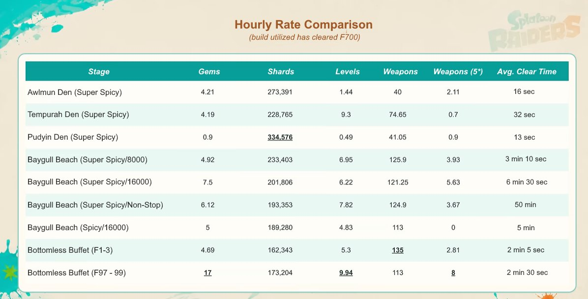

---
tags:
  - Farming
  - Endgame
---

# Endgame grinding masterguide

!!! abstract "Game data"
    Stages, modes and loot details: [Splatoon Raiders on Inkipedia](https://splatoonwiki.org/wiki/Splatoon_Raiders)

**Mode:** postgame · **Goal:** shards, gems, weapons, XP, relics · **Guide by:** Sun (owner of the [Spirhalite Raiders](https://discord.gg/MrskbxSWQK) Discord)

Based on hourly drop rates measured by
[Tarotaro](https://x.com/tarotaro0_game/status/2083375217456697552), translated
into English by [@Spartan_212](https://x.com/Spartan_212/status/2083633982382514240).

## TL;DR

The best endgame grinding spots, with their community nicknames:

- **Awlmun Den** ("Stinger den 2")
- **Tempurah Den** ("Salty tongue den")
- **Pudyin Den** ("Small fry den")
- **Baygull Beach**
- **Bottomless Buffet, floors 97–99**

**If you can clear Bottomless Buffet F97–99 easily, grind there:** it's the best
spot for most items. If you can't, or don't want the hassle, **Awlmun Den** is a
low-effort, easy-to-grind alternative.

## The data

Hourly averages measured by Tarotaro on Super Spicy (unless noted), with a build
that had cleared F700. **Bold** marks the best value in each column.

| Stage                                  | Gems   | Shards      | Levels   | Weapons | Weapons (5★) | Avg. clear time |
| -------------------------------------- | ------ | ----------- | -------- | ------- | ------------ | --------------- |
| Awlmun Den                             | 4.21   | 273,391     | 1.44     | 40      | 2.11         | 16 s            |
| Tempurah Den                           | 4.19   | 228,765     | 9.3      | 74.65   | 0.7          | 32 s            |
| Pudyin Den                             | 0.9    | **334,576** | 0.49     | 41.05   | 0.9          | 13 s            |
| Baygull Beach (8000)                   | 4.92   | 233,403     | 6.95     | 125.9   | 3.93         | 3 min 10 s      |
| Baygull Beach (16000)                  | 7.5    | 201,806     | 6.22     | 121.25  | 5.63         | 6 min 30 s      |
| Baygull Beach (Non-Stop)               | 6.12   | 193,353     | 7.82     | 124.9   | 3.67         | 50 min          |
| Baygull Beach (Spicy, 16000)           | 5      | 189,280     | 4.83     | 113     | 0            | 5 min           |
| Bottomless Buffet F1–3                 | 4.69   | 162,343     | 5.3      | **135** | 2.81         | 2 min 5 s       |
| Bottomless Buffet F97–99               | **17** | 173,204     | **9.94** | 113     | **8**        | 2 min 30 s      |

Your own numbers will vary: they depend on your clear times, and drops are random.

??? quote "@Spartan_212 · 2026-08-01: original chart (English translation)"
    { loading=lazy }

    [:material-link: Original post](https://x.com/Spartan_212/status/2083633982382514240) ·
    [:material-link: Tarotaro's original chart (Japanese)](https://x.com/tarotaro0_game/status/2083375217456697552)

## What to grind for what

- **Shards:** Super Spicy **Pudyin Den** drops the most.
- **Weapons (any rarity):** **Bottomless Buffet F1–3** drops the most.
- **Gems, 5★ weapons and XP:** **Bottomless Buffet F97–99** is the best.

## Myths and pitfalls

!!! failure "Going deeper into Bottomless Buffet gets you better loot"
    **False.** Past floor 100, Bottomless Buffet is heavily randomized. If
    anything you'll get worse loot, and grinding past F100 isn't better than
    any of the methods above.

- **"Mine the huge crystal" missions** have a 250-item limit. Don't stay in them
  for long: you'll end up with fewer shards overall.
- **Everything is random.** No place guarantees a specific weapon or relic.
- **Weapon drops:** using a weapon of the same class gives a 5% boost to that
  class's drop rate. It's small and guarantees nothing.
- Be wary of grinding theories that don't have a lot of evidence behind them.

## Relics

Relics work differently from other loot: you only get one by beating a level
that ends with collecting a **treasure chest**.

- Every spot in this guide **except Baygull Beach** can give you a relic.
- Relics are random and nothing guarantees one. Be patient: by just playing
  postgame you'll eventually get every relic.

## Disclaimer

These numbers are statistically solid, but luck still matters. You might get
bad drops on F97–99 and great ones on F1–3. With a small number of runs, it's
easy to be convinced something different is true. Nothing guarantees you'll get
amazing loot, and nothing guarantees you won't: the game is really, really
random.

## Video

Tarotaro's video, in Japanese, comparing the hourly efficiency of each grinding
stage:

<iframe class="video" src="https://www.youtube-nocookie.com/embed/3T8NLTXcvC4" title="Splatoon Raiders: grinding stage time-efficiency comparison" loading="lazy" allowfullscreen></iframe>

## Sources

- Guide written by **Sun**, owner of the [Spirhalite Raiders](https://discord.gg/MrskbxSWQK) Discord
- [Original measurements and chart](https://x.com/tarotaro0_game/status/2083375217456697552) by Tarotaro ([@tarotaro0_game](https://x.com/tarotaro0_game))
- [Video](https://youtu.be/3T8NLTXcvC4) by [Tarotaro](https://www.youtube.com/@tarotaro-game)
- [English translation of the chart](https://x.com/Spartan_212/status/2083633982382514240) by [@Spartan_212](https://x.com/Spartan_212)
